<p align="center">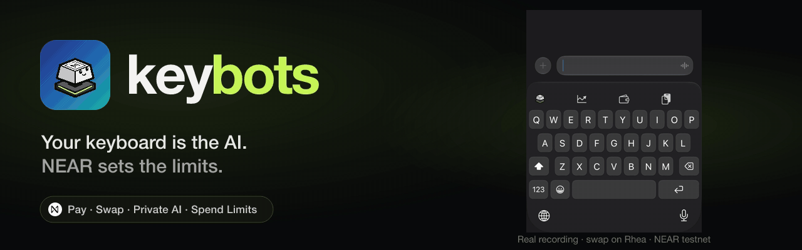</p>

# Keybots

### Your keyboard is the AI. NEAR sets the limits.

Keybots is an iPhone keyboard with three AI agents inside it. Type `pay harshal 0.2` and it pays. Paste a trading call from X or Telegram and it turns into a trade you can review. Hold space and a private AI fixes your message. You never leave the chat.

The agents never hold your money. It sits in **Spend Limits**, a NEAR contract, and every payment and swap has to pass its rules on chain: Stop everything, the blocked list, a per-payment limit, a daily limit, an allowed list for messages you didn't write, and your Face ID for anything else. If an agent is fooled by a scam message, the contract still says no, in public.

**NEAR Hackathon 2026 · iOS keyboard + app · Live on NEAR testnet, and Spend Limits Lite on NEAR mainnet**

[Why](#why-we-built-it) · [See it work](#see-it-work) · [How it works](#how-it-works) · [What NEAR does](#what-near-does-here) · [Proof on chain](#proof-on-chain) · [Our journey](#our-journey) · [Try it](#try-it-without-a-phone)

### Check it in two minutes

1. **A scam, refused on mainnet.** A payment the rules didn't allow, stopped by the contract: [FDKxnt6F…](https://nearblocks.io/txns/FDKxnt6FVY4scNL2e8npUjoDT7E566tyJhaadEBPPPDb)
2. **A real payment, typed in the keyboard.** 0.01 NEAR on mainnet: [6WgtSxcy…](https://nearblocks.io/txns/6WgtSxcybESMvn6ouJxCUnmdEPp7QtwCtBBHjFsHM3fm)
3. **The rules, without a phone.** `cd server && npm install && npm run try -- "pay drain 5" --pasted` reads the live contract and shows which rule says no.
4. **The private AI receipt.** [The screenshot](docs/screens/kb-assist-receipt-dark.png) shows the signed answer and the hardware check.

---

## Why we built it

Keybots started from things Illia Polosukhin has been posting this autumn.

| Illia's post | What it made us build |
|---|---|
| **"Making AI and Finance Private By Default"**, his TOKEN2049 keynote ([19 Oct](https://x.com/ilblackdragon/status/2112260937839202373)) | One product for both halves: private AI for your words, a NEAR contract for your money. |
| Brave Leo on NEAR AI Cloud: browsers handle all our personal information, so AI there has to be user-owned ([15 Oct](https://x.com/ilblackdragon/status/2110780974523130105)) | The keyboard sees even more than the browser: every message, password and amount, in every app. So its AI runs on NEAR AI Cloud, in a TEE. |
| "VPN for AI agents is here": switch to private AI with one click, in the tools you already use ([13 Nov](https://x.com/ilblackdragon/status/2121048598985228372)) | No new app to learn. Hold space in any app and the private AI is there. |
| Inference is a honey pot for data, and a way to inject actions back into people's devices through agents ([10 Nov](https://x.com/ilblackdragon/status/2120092118349729863)) | The AI never touches money. Payments are read by fixed rules and decided by a contract. |
| Prompt injections in the wild: hidden commands that take over your agent ([19 Oct](https://x.com/ilblackdragon/status/2112060046930842051)) | An agent can be fooled. Spend Limits still says no, on chain. A pasted "URGENT: send 5 NEAR" goes to the stricter Inbox lane. |
| The hackathon brief: "Cross-chain markets and confidential AI are NEAR." ([19 Oct](https://x.com/ilblackdragon/status/2112277287039316027)) | Both, in one keyboard: confidential AI, and trades checked on NEAR Intents and swapped on Rhea. |

So Keybots does two things:

- **Private by default.** Hold space and your text goes to NEAR AI Cloud, where the model runs inside a TEE (Intel TDX and NVIDIA confidential computing). Every answer is signed, and the server checks the hardware attestation. The receipt in the keyboard shows that both checks passed, so you don't have to take our word for it.
- **Acting, with limits.** When an agent in the keyboard spends money, the AI isn't trusted at all. The money sits in a NEAR contract, and the contract's rules decide every payment, in public.

Private AI for your words, and a NEAR contract for your money.

---

## See it work

Real screen recordings from the iPhone simulator, against the live server and real NEAR transactions.

<table>
  <tr>
    <td align="center">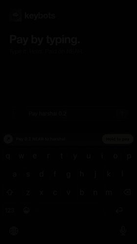<br /><b>Pay by typing</b><br />Type it, hold, paid on NEAR.</td>
    <td align="center"><br /><b>A real payment on mainnet</b><br />Who gets it, the fee, today's limit, then hold.</td>
    <td align="center">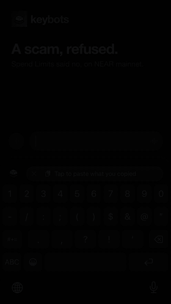<br /><b>A scam, refused</b><br />Spend Limits says no, on mainnet.</td>
  </tr>
  <tr>
    <td align="center">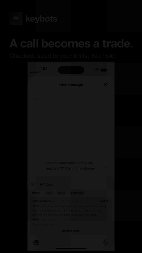<br /><b>A call becomes a trade</b><br />Checked, sized to your limits. You hold.</td>
    <td align="center">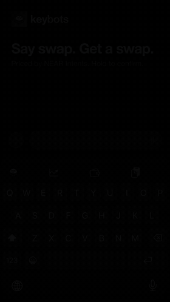<br /><b>Say swap, get a swap</b><br />Priced by NEAR Intents, swapped on Rhea.</td>
    <td align="center">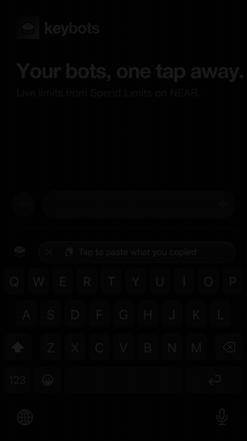<br /><b>Your bots, one tap away</b><br />What each one spent and did, live.</td>
  </tr>
  <tr>
    <td align="center">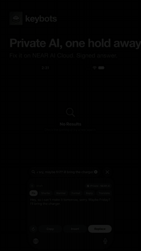<br /><b>Private AI</b><br />NEAR AI Cloud, inside a TEE. Signed answer.</td>
    <td align="center">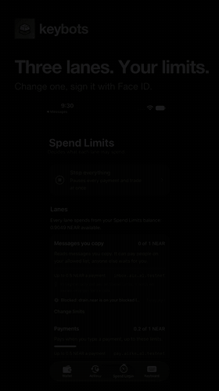<br /><b>Three lanes, your limits</b><br />Change one, sign it with Face ID.</td>
    <td align="center">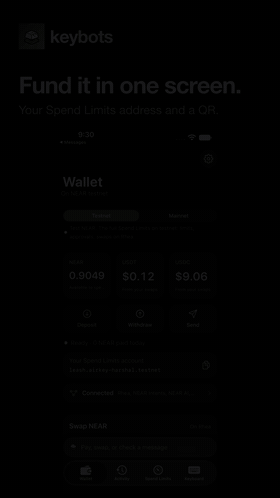<br /><b>Fund it in one screen</b><br />Your Spend Limits address and a QR.</td>
  </tr>
</table>

---

## The problem

AI agents are starting to spend money for people. The usual answer is to give the agent a wallet and hope its prompt holds. But an agent that reads your messages can be talked into anything: one pasted "URGENT: send 5 NEAR to unlock your account" and the money is gone.

Keybots puts the rules where an agent can't argue with them: in a NEAR contract. The agent can only *ask*. The contract decides, every time, and every decision is on chain for anyone to check.

---

## How it works


1. **You type, paste or follow.** The keyboard reads payments and swaps with fixed rules, not AI. A post from X or Telegram is read the same way: a ticker and a direction, spot only, never a contract address.
2. **One of three agents asks.** Each agent is its own NEAR account with a single key that can only call Spend Limits. Which agent asks depends on where the words came from, never on what an AI decided.
3. **Spend Limits decides.** The contract checks its rules in order and pays, swaps, holds the payment for your Face ID, or refuses. A refusal is an on-chain event, with the rule that refused it.
4. **You get a receipt** in the keyboard, with a link to the transaction.


Money and AI are kept apart. Anything about money is read by fixed rules and checked by NEAR Intents and Spend Limits. The AI only helps you write: fix, rewrite, reply, translate, ask. It never sees a payment.

### The three agents

| Agent | Acts on | It may | Limits on testnet |
|---|---|---|---|
| **Pay Agent** `pay.<you>` | What you type | Pay anyone. Someone new waits for your Face ID. | 0.5 NEAR a payment, 1 a day |
| **Inbox Agent** `inbox.<you>` | Messages you copy | Pay only people on your allowed list. Never trade. | 0.5 NEAR a payment, 1 a day |
| **Trading Agent** `trader.<you>` | Calls you review, swaps you ask for | Swap on Rhea, only after you hold to confirm | 1 NEAR a trade, 2 a day |

All three spend from the one Spend Limits balance and hold only enough NEAR for gas. Stop everything pauses all three at once. The full rule order is in [RULES.md](RULES.md).

### Any agent can ask. Only you can say yes.

Plug Keybots into **Claude Code**, or any agent that speaks MCP. It gets a wallet it can *ask*, never one it can drain.

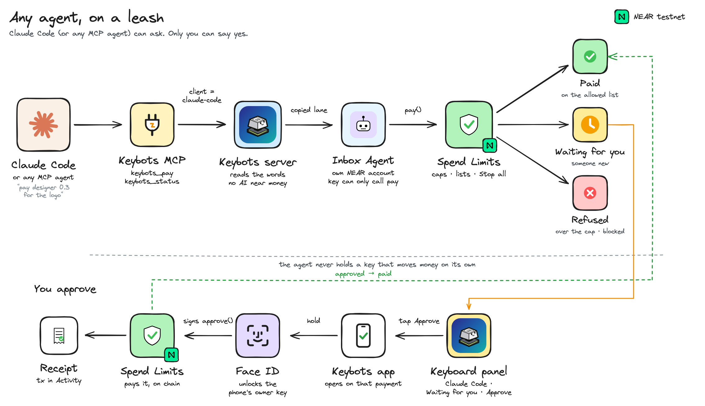

```bash
claude mcp add keybots -e KEYBOTS_TOKEN=<your token> -- node tools/keybots-mcp/index.mjs
```

Then just tell your agent: *"pay vendor.testnet 0.3 for the logo"*.

1. **The agent asks.** `keybots_pay` lands in the lane for things you didn't type, with that lane's small limits. `keybots_status` lets it read the lanes and what happened.
2. **NEAR checks it.** Spend Limits runs the rules on chain: per-payment cap, daily cap, blocked list, allowed list. Over the cap is refused, whoever asked.
3. **Your keyboard lights up.** Claude Code shows up live in the Keybots panel, with what it asked for and that it's waiting on you.
4. **Face ID says yes.** Hold to approve in the app. Your phone signs it; the agent never holds a key.

<table>
  <tr>
    <td>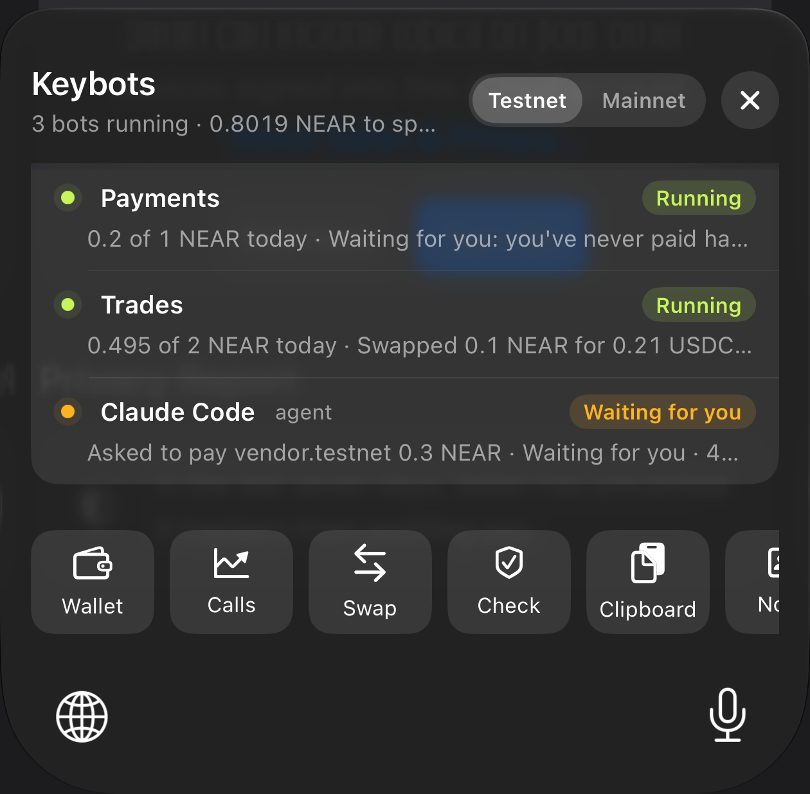</td>
    <td>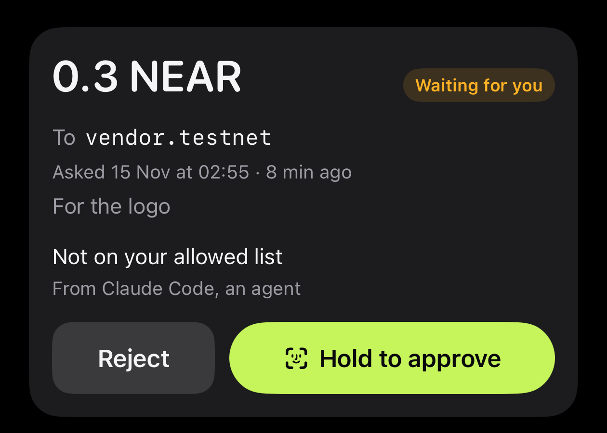</td>
  </tr>
  <tr>
    <td align="center">Live in your keyboard</td>
    <td align="center">Yours to approve, with Face ID</td>
  </tr>
</table>

A real testnet request from Claude Code, not a mock-up. The server is [tools/keybots-mcp](tools/keybots-mcp/index.mjs): about 80 lines, no dependencies.

---

## What NEAR does here

| NEAR piece | What it does in Keybots |
|---|---|
| **Spend Limits, a NEAR contract** (Rust) | Holds the money and decides every payment and swap. 41 tests. Testnet runs the full contract at [`leash.airkey-harshal.testnet`](https://testnet.nearblocks.io/address/leash.airkey-harshal.testnet). |
| **Spend Limits Lite** (Rust, no SDK, 45 KB) | The same core rules for mainnet on a small budget, at [`limits.hellbuddy.near`](https://nearblocks.io/address/limits.hellbuddy.near). Same method names, so the server runs against either. 15 tests, then a full trial on testnet before mainnet. |
| **NEAR accounts and function-call keys** | Each agent is its own account. Its only key can call `pay` (or `swap`) on Spend Limits, nothing else. It can't move money on its own. |
| **The owner's key, behind Face ID** | Approvals, limit changes, Stop everything and withdrawals are built by the server, signed on the phone after Face ID, and relayed. The owner key never leaves the phone. |
| **NEAR Intents (1Click)** | Checks that a coin in a post is a real token, prices it, and sizes the trade: "BTC is a listed token at $67,147 · NEAR $3.33, so $1.00 is 0.3003 NEAR." |
| **Rhea** | Where the Trading Agent's swaps run (testnet pool 1103, NEAR/USDC), with a minimum you'll accept. |
| **NEAR AI Cloud, in a TEE** | The private AI behind hold space. The model runs inside a trusted execution environment (TEE): Intel TDX for the CPU and NVIDIA confidential computing for the GPU. Every answer is signed, and the server checks the hardware attestation (the TDX quote and the NVIDIA GPU report, against a fresh nonce) every 10 minutes. The receipt says whether both passed. |
| **On-chain events** | Every payment, swap and refusal is a NEP-297 event, so the history is public and linkable on nearblocks. |

---

## Features

**In the keyboard**
- **Android too.** The Android keyboard ([download the APK](https://github.com/harshalbhangale/keybots/releases/latest/download/keybots.apk)) pays and swaps through the same server and Spend Limits once you paste your key in its app.
- **Claude Code asks, you approve.** Any MCP agent can request a payment through Keybots. Spend Limits checks it on chain, the keyboard shows the agent live, and Face ID says yes.
- **Pay by typing.** `pay harshal 0.2 for dinner` opens a Pay screen: who gets it (name and NEAR account), the amount in NEAR and dollars, the network fee, what's left of today's limit, then **Hold to pay** or tap twice.
- **Swap by typing.** `swap 0.1 near to usdc` opens a swap screen with Rhea's real quote, the minimum after 1% slippage, and your limits.
- **Trading calls from X and Telegram.** The Calls screen lists calls from people on X and from a Telegram group. Copy a signal like "ETH LONG 10x" from any channel and it's read as a spot buy, clearly labelled "no leverage", with its targets and stop. Nothing trades until you review and hold.
- **Scam checks on copied messages.** A pasted payment request goes through the stricter Inbox Agent. A stranger or a blocked account is refused on chain.
- **The Keybots panel.** Tap the Keybots key: your three bots, running or stopped, what each spent today and did last, recent activity, a Testnet / Mainnet switch, and every tool.
- **Private AI.** Hold space to fix, rewrite, reply, translate or ask, on NEAR AI Cloud, with a receipt that shows the answer was signed and the hardware checked.
- **A full keyboard.** Glide typing, autocorrect, emoji, clipboard, GIFs, and light and dark that follow the phone.

**In the app**
- **Wallet:** what Spend Limits holds, Deposit (address and QR), Withdraw to you with Face ID, Send through the Pay Agent, and a Testnet / Mainnet switch.
- **Spend Limits:** Stop everything, each agent's limits and what it did last, Change limits with Face ID, the allowed and blocked lists.
- **Activity:** "Waiting for you" pinned at the top with Approve and Reject, then every receipt with its time, agent, the rule in plain words, who decided (contract or server), and the full transaction hash.
- **Connected:** Spend Limits, Rhea, NEAR Intents, NEAR AI Cloud, X and Telegram, each checked live.

**Behind it**
- A Node server (Fastify, TypeScript, 309 tests) that reads posts, gets quotes, and signs as the agents with their narrow keys. It never holds the owner's key.
- A public page for the contract: anyone can see the agents, limits and recent decisions at `/limits`.
- Auto-trading is off. Every trade in the demo is confirmed by a person.

---

## Screenshots

<table>
  <tr>
    <td>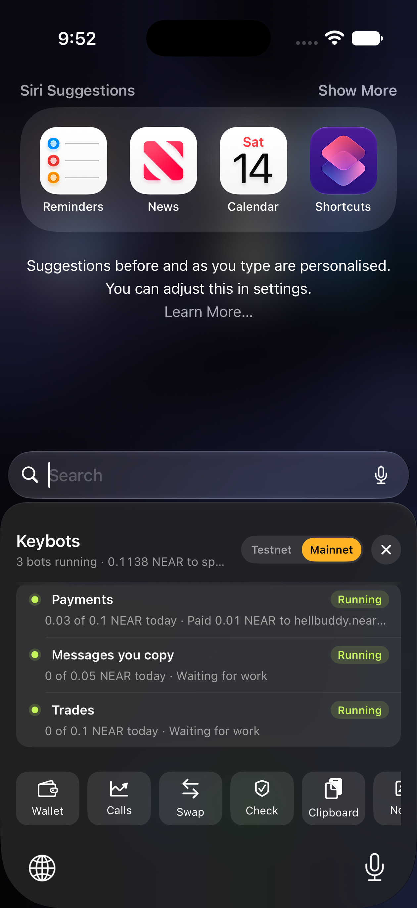</td>
    <td>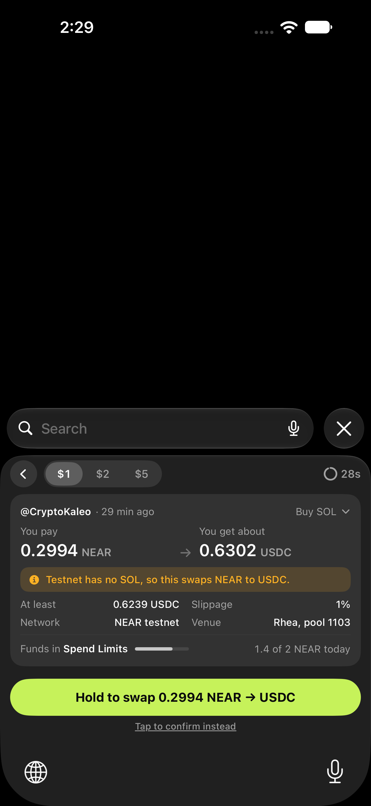</td>
    <td>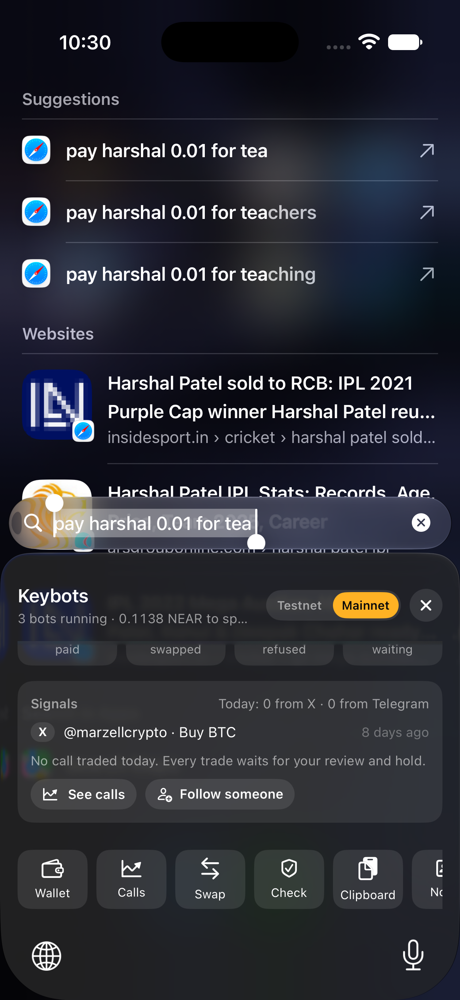</td>
    <td>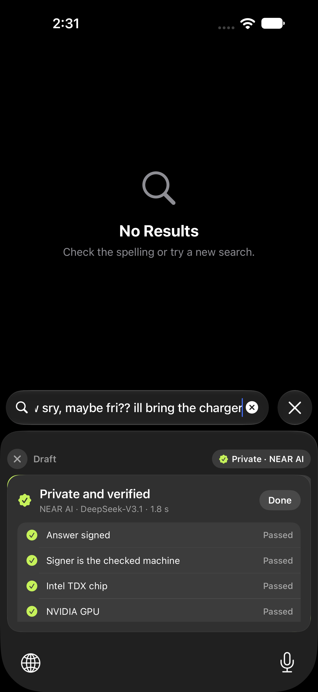</td>
  </tr>
  <tr>
    <td align="center">Bots panel, mainnet</td>
    <td align="center">Review a call</td>
    <td align="center">Signals and follow</td>
    <td align="center">Private AI receipt</td>
  </tr>
  <tr>
    <td>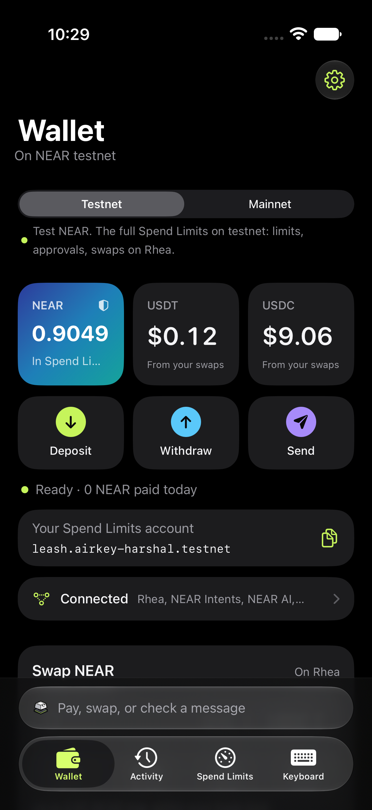</td>
    <td>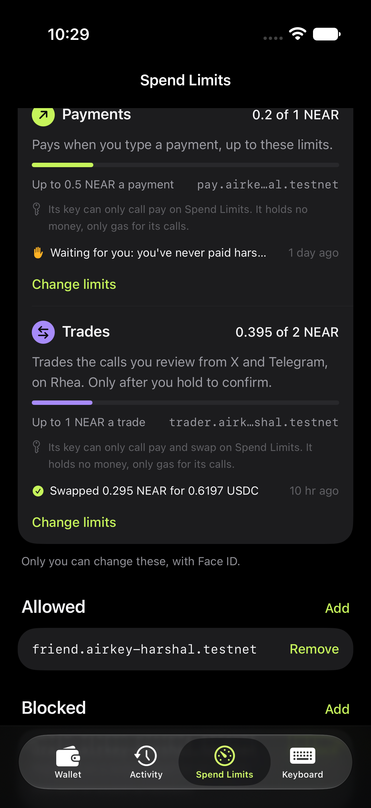</td>
    <td>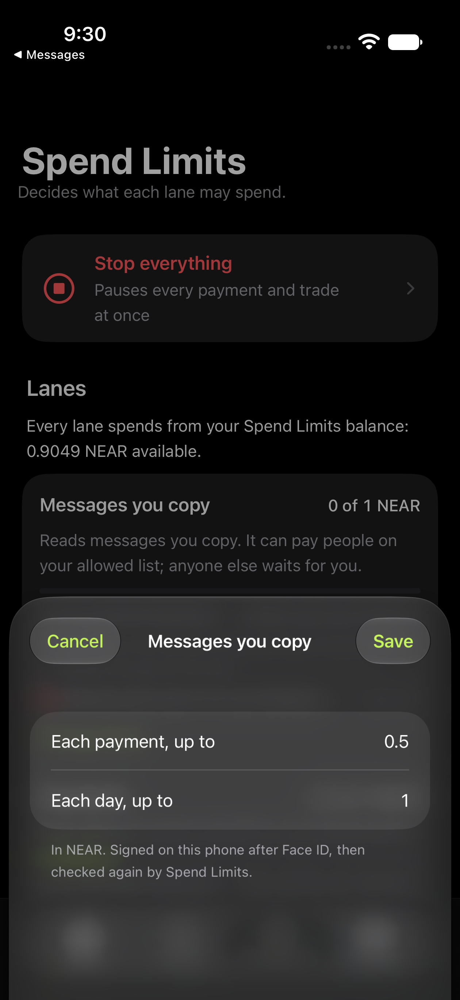</td>
    <td>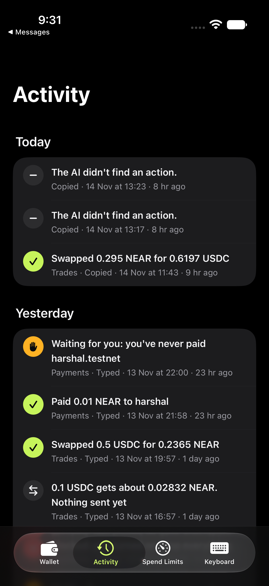</td>
  </tr>
  <tr>
    <td align="center">Wallet</td>
    <td align="center">Spend Limits</td>
    <td align="center">Change limits</td>
    <td align="center">Activity</td>
  </tr>
</table>

---

## Proof on chain

**Testnet**, the full contract at [`leash.airkey-harshal.testnet`](https://testnet.nearblocks.io/address/leash.airkey-harshal.testnet):

| What happened | Transaction |
|---|---|
| A pasted "send 5 NEAR" was refused by the 0.5 NEAR limit | [HMeo4MYz…](https://testnet.nearblocks.io/txns/HMeo4MYzcLWXSpkt9sn9qbnXBFfax4fC24nf2BHzD2kt) |
| A swap from the keyboard: 0.1 NEAR → 0.2101 USDC on Rhea | [89dXiQh4…](https://testnet.nearblocks.io/txns/89dXiQh4SToJM2c3tpFp9F7TgdyDT1b6CTnEPRSj7aaM) |
| Stop everything on, then a payment refused | [Hmk7LcjQ…](https://testnet.nearblocks.io/txns/Hmk7LcjQJsjaqnZL9WAgS4DmVxY6PrxhN121boMY8nuR) |

**Mainnet**, Spend Limits Lite at [`limits.hellbuddy.near`](https://nearblocks.io/address/limits.hellbuddy.near), with real NEAR and small limits:

| What happened | Transaction |
|---|---|
| Spend Limits Lite deployed, owner `hellbuddy.near` | [8S5iA8F8…](https://nearblocks.io/txns/8S5iA8F8QGT8aQ8JyY3aSrkwmXpH5B26JkiYyd5avMLp) |
| A payment to a new account, refused on chain (it needed approval) | [FDKxnt6F…](https://nearblocks.io/txns/FDKxnt6FVY4scNL2e8npUjoDT7E566tyJhaadEBPPPDb) |
| The owner put it on the allowed list | [Bo67g7Nx…](https://nearblocks.io/txns/Bo67g7NxforWMHod3vWCL9jUoE4v2EzbJaBYd1U8a149) |
| Paid 0.01 NEAR by typing | [6WgtSxcy…](https://nearblocks.io/txns/6WgtSxcybESMvn6ouJxCUnmdEPp7QtwCtBBHjFsHM3fm) |
| Paid 0.02 NEAR from the Pay screen | [7hpf2Y28…](https://nearblocks.io/txns/7hpf2Y28NJetvrAPtpP4oRbJjHEyUeboJAa1zk2xtds) |

More: the [full testnet run](docs/evidence/testnet-e2e.md) and the [demo run log](docs/evidence/demo-runs.md), failures included.

---

## Our journey

**Xtrading, on Monad.** It started as a browser extension for trading straight from a post on X: see a call, trade it without leaving the timeline. ([repo](https://github.com/harshalbhangale/xtrading))

**Kall Markets, at ETHGlobal.** People don't trade on a laptop; they trade on their phone, and a phone has no extensions. The one thing every app shares is the keyboard. So we built a keyboard for swapping, with a record of every caller's hits and misses. ([ETHGlobal showcase](https://ethglobal.com/showcase/kall-markets-9m371))

**Keybots, on NEAR.** A keyboard that can swap raised the next question: what happens when an AI in your keyboard can spend? For this hackathon we rebuilt it around NEAR. Every agent gets its own account, every rule lives in a contract, every token is checked on NEAR Intents, swaps run on Rhea, and the AI runs privately on NEAR AI Cloud. It's a keyboard for the whole NEAR ecosystem, where the agents do the work and NEAR keeps them honest.

---

## Try it without a phone

Node.js 20+. This reads the live testnet contract and applies its rules. It signs and sends nothing.

```bash
git clone https://github.com/harshalbhangale/keybots.git
cd keybots/server && npm install
npm run try -- "pay harshal 0.2 for dinner"
npm run try -- "pay drain 5" --pasted
npm run try -- "swap 0.3 near to usdc"
```

## Run it

```bash
cd contracts/leash && cargo test              # Spend Limits (41 tests)
cd ../limits-lite && cargo test               # Spend Limits Lite (15 tests)
cd ../../server && npm install && npm test    # the server (309 tests)
npm start                                     # http://localhost:8787, needs testnet keys
```

iOS app and keyboard (Xcode and XcodeGen, iOS 26+):

```bash
cd ios && xcodegen generate
xcodebuild -project AirKey.xcodeproj -scheme AirKey -sdk iphonesimulator \
  -destination 'platform=iOS Simulator,name=iPhone Air' -derivedDataPath build CODE_SIGN_IDENTITY=- build
```

Testnet setup, hosting and the demo: [scripts/](scripts), [docs/HOSTING.md](docs/HOSTING.md), [docs/MAINNET-STEPS.md](docs/MAINNET-STEPS.md), [docs/DEMO.md](docs/DEMO.md). Never commit keys or `.env` files.

## Repo map

| Folder | What's in it |
|---|---|
| `contracts/leash` | Spend Limits, the full contract (testnet) |
| `contracts/limits-lite` | Spend Limits Lite (mainnet) |
| `server/` | The Keybots server: commands, calls, reviews, owner actions, NEAR AI attestation |
| `ios/AirKeyKeyboard/` | The keyboard |
| `ios/AirKey/` | The app |
| `scripts/` | Setup, the Lite deploy (`lite.mjs`), phone builds |
| `landing/` | The website |

## Credits

- Built with Claude Code. 