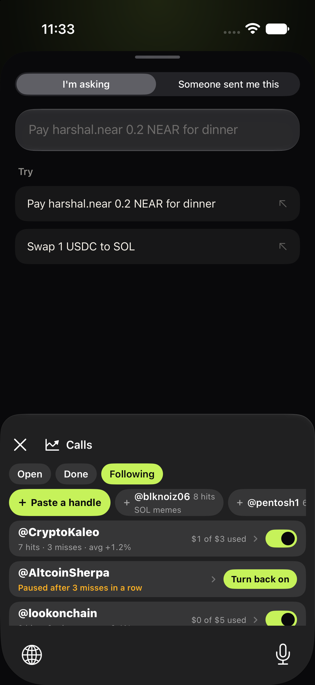
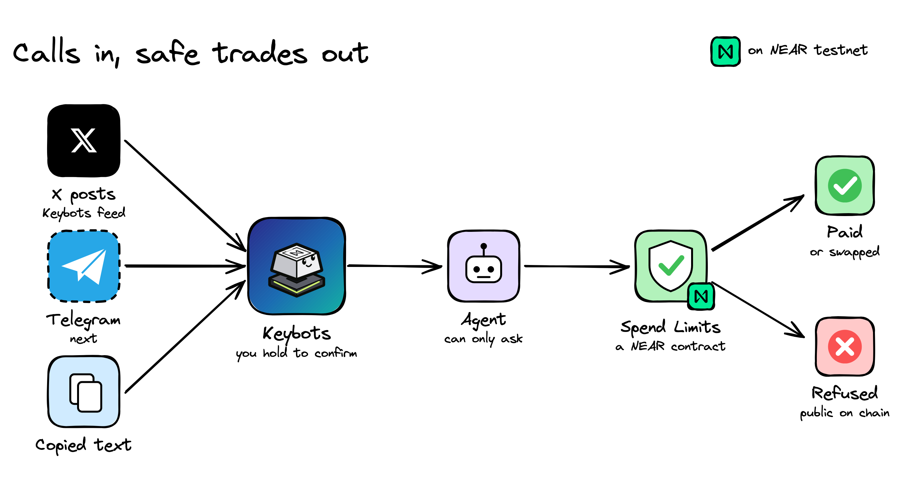
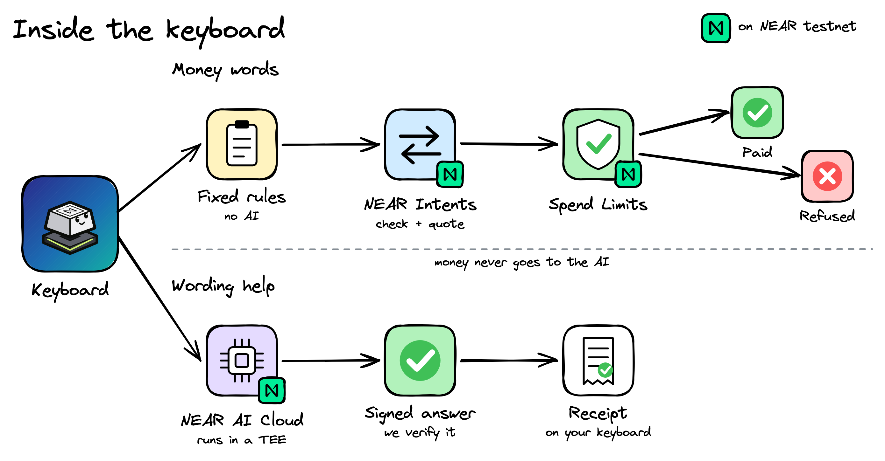

# Keybots

### Your keyboard is the AI. NEAR is the leash.

Keybots is an iPhone keyboard for the moment between reading something and doing something about it. Pay a friend, review a swap, check a copied message, or rewrite a reply—without leaving the conversation. A NEAR smart contract puts limits around what its agents can do with money.

**Built for NEAR Hackathon · iOS · NEAR testnet · Work in progress**

> **Name:** The project is called Keybots. The current iOS app, code and screenshots still use AIRKEY; setup instructions use those existing names.

[See the demo script](docs/DEMO.md) · [Testnet evidence](docs/evidence/testnet-e2e.md) · [How the rules work](RULES.md) · [Try the dry run](#try-it-without-a-phone)

> **Testnet prototype, not financial advice or production-ready wallet software.** The leash has not enforced a mainnet swap. Screens and integrations may depend on configuration, network availability and signing capabilities.

## Why a keyboard?

The conversation is already where decisions happen. Someone sends a payment request. A trader shares a call. You want to reply in another language. Normally, each means switching apps, copying context and starting again.

Keybots brings the next step to the place you are already typing—and puts a contract, not a model, in charge of spending limits.

## See it in action

<table>
  <tr>
    <td align="center"><strong>Swap in a conversation</strong></td>
    <td align="center"><strong>AI assistance</strong></td>
    <td align="center"><strong>A risky request, blocked</strong></td>
    <td align="center"><strong>Follow trading calls</strong></td>
  </tr>
  <tr>
    <td></td>
    <td></td>
    <td></td>
    <td></td>
  </tr>
</table>

Screens are from the project demo; provider badges and results depend on the configured service and the actual verification result. [More screenshots](docs/screens) · [Demo walkthrough](docs/DEMO.md)

## What you can do

- **Type a payment.** Write `pay harshal 0.2 for dinner`, review the action and hold to send. Share the resulting receipt in the chat.
- **Swap on NEAR.** Write `swap 0.1 near to usdc` and review the amount, rate, minimum received, route and limits before holding to confirm. The documented testnet execution uses Rhea; token checks and quotes use NEAR Intents.
- **Check copied text.** Copy a payment request or market call and use the keyboard's check action. An untrusted payment goes through the Inbox Agent's stricter rules. A copied market call can become a trade chip that requires a hold to confirm.
- **Follow trading calls.** The Calls interface uses records and calls from [Kall Markets](https://kallmarkets.vercel.app), not a complete feed of X or Telegram. Optional auto-trading is off unless explicitly enabled and uses per-person rules and the Trading Agent's contract limits. Auto-trading can place trades without a separate hold for each call.
- **Use AI while typing.** Hold space for rewrite, tone, reply, translate, Ask and Search. Review the result before inserting or replacing text. NEAR AI Cloud support includes response-signature and attestation checks; see the [privacy limits](#ai-and-privacy) below.
- **Use it as a keyboard.** Autocorrect, suggestions, swipe typing, cursor movement, emoji, clipboard, themes and haptics are part of the everyday experience. The vault is for addresses, not private keys or seed phrases.

## Why NEAR?

| NEAR building block | What Keybots uses it for |
|---|---|
| **Smart contract** | The Rust leash holds testnet funds and checks spending rules for payments and swaps. Decisions emit on-chain events. |
| **Accounts and function-call keys** | Payment, Inbox and Trading agents have separate accounts and constrained keys. They can call permitted leash methods rather than hold unrestricted transfer authority. |
| **Rhea** | The documented testnet NEAR-to-stablecoin swaps execute through Rhea and return the output to the leash. |
| **NEAR Intents** | Token identification, prices and quotes. The mainnet deposit path is in code, but has not been proven by an enforced mainnet swap. |
| **NEAR AI Cloud** | An optional configured AI provider with code for response-signature verification and TEE attestation checks. It is not the same privacy guarantee as the OpenAI fallback. |

## Architecture

Two sketches show how it fits together. You can edit them: the Excalidraw files are in [`docs/diagrams`](docs/diagrams).

**How a call becomes a safe trade**



X posts (through the Keybots feed) and copied text go into the Keybots keyboard, an agent with its own NEAR account asks the Spend Limits contract on NEAR testnet, and the result is paid or refused on chain (Telegram is dashed: built on a branch, not in this submission).

**Inside the keyboard**



Money words go through fixed rules, NEAR Intents (token check and quote) and the Spend Limits contract, while wording help goes to Qwen3-VL 30B on NEAR AI Cloud (NEAR's TEE) and comes back as a signed answer with a receipt.

### How it works, one line each

| Piece | In one line |
|---|---|
| **Keyboard** | An iOS keyboard that shows what your words would do (`Pay 0.2 NEAR to harshal`) and only acts when you hold the button, never on a tap, and it never holds a key. |
| **Typing stays safe** | Autocorrect never touches money, names, accounts, tickers or numbers, and text that reads as a payment is never sent to the AI. |
| **Typed vs pasted** | What you type goes to the trusted Pay Agent, and text from someone else goes to the Inbox Agent, which can't trade and can only pay people you allowed. |
| **AI model** | Qwen3-VL 30B Instruct (`Qwen/Qwen3-VL-30B-A3B-Instruct`) on NEAR AI Cloud, and the receipt on the keyboard shows which model answered. |
| **Private AI** | Private AI on NEAR AI Cloud (runs in NEAR's TEE): every answer's signature is verified and its signer is the address NEAR's hardware attests; the TDX and GPU verdicts come from Phala and NVIDIA's verifiers. |
| **AI help** | Hold space for fix, rewrite, tone, reply, translate, ask or search, and nothing enters your message until you tap Replace, Insert or Copy. |
| **Agents** | Pay, Inbox and Trading are separate NEAR accounts whose only key can call a few contract methods, so a fooled agent still can't move money on its own. |
| **Spend Limits (the leash)** | A Rust contract on NEAR holds the funds and decides every payment and swap in a fixed order: stop switch, blocklist, per-payment cap, daily cap, allowlist, owner approval. |
| **NEAR Intents** | Checks that a token is real against its token list and gives live quotes, as dry runs that send nothing. |
| **Swap** | `swap 0.1 near to usdc` makes the Trading Agent ask the contract, which swaps on Rhea on testnet and keeps the result inside the contract. |
| **Calls** | A call from X (through the Keybots feed) or from copied text becomes one small trade chip that waits for your hold, and auto-trading is off unless you turn it on. |
| **Receipts** | Every decision, paid or refused, is an on-chain event with a testnet explorer link, and Share puts the receipt in your chat. |
| **Testnet and mainnet** | It runs on NEAR testnet today, where every payment and swap is enforced by the contract, and mainnet is next: the code path for live NEAR Intents quotes and deposits exists, but the contract is not deployed on mainnet and no mainnet swap has been enforced yet. |

### Why this matters

A keyboard sees what you write before anyone else does. When you ask the AI to improve "Mom, I'm coming late tonight, don't wait for dinner", to soften a message to your boss, to reply to your landlord about the rent, or to translate "I can't pay until Friday", you are handing it the most personal text on your phone. It is also where money gets typed, so the keyboard keeps the two apart:

- **Money never goes to the AI.** Text that reads as a payment or trade is handled by fixed rules and the Spend Limits contract, never by a model.
- **You stay in charge of the words.** Nothing enters your message until you tap Replace, Insert or Copy, and Replace can be undone for five seconds.
- **Private by design.** Private AI on NEAR AI Cloud (runs in NEAR's TEE): every answer's signature is verified and its signer is the address NEAR's hardware attests; the TDX and GPU verdicts come from Phala and NVIDIA's verifiers.
- **You can see who answered.** The receipt on the keyboard names the model and whether its signature verified. The limits of these checks are listed under [AI and privacy](#ai-and-privacy).

**A payment's path:** the keyboard previews a typed command → the server selects the agent and checks the receiver → the agent's restricted key calls the leash → the contract pays, blocks or records an approval request → Keybots shows the outcome and transaction receipt.

**Important trust boundary:** the server relies on the client-supplied `typed` or `pasted` source to select a trust tier. The contract enforces the tier assigned to the agent account, but cannot independently prove where the text originated. Restricted keys and contract rules reduce risk; they do not guarantee detection of every scam or prevent losses within allowed limits.

See [`RULES.md`](RULES.md) for the decision order and [`contracts/leash/src/lib.rs`](contracts/leash/src/lib.rs) for enforcement.

## Proof on testnet

The deployed contract is [`leash.airkey-harshal.testnet`](https://testnet.nearblocks.io/address/leash.airkey-harshal.testnet). These links are recorded examples, not a guarantee that a fresh run will succeed:

| Action | What happened | Evidence |
|---|---|---|
| Pasted request: send 5 NEAR | Blocked by a 0.5 NEAR per-payment cap | [Testnet transaction](https://testnet.nearblocks.io/txns/HMeo4MYzcLWXSpkt9sn9qbnXBFfax4fC24nf2BHzD2kt) |
| Swap from the keyboard | 0.1 NEAR → 0.2101 USDC on Rhea | [Testnet transaction](https://testnet.nearblocks.io/txns/89dXiQh4SToJM2c3tpFp9F7TgdyDT1b6CTnEPRSj7aaM) |
| Copy a SOL call, hold to buy | On testnet the demo swaps **NEAR → USDC**, not SOL; the UI explains the substitution | [Testnet transaction](https://testnet.nearblocks.io/txns/7XUq6MLFCiPL15FynnKsyWp9KCx6Ki7pc2WsgTDqRUey) |
| Pause the leash | A later keyboard payment was blocked by the kill switch | [Testnet transaction](https://testnet.nearblocks.io/txns/Hmk7LcjQJsjaqnZL9WAgS4DmVxY6PrxhN121boMY8nuR) |

The [end-to-end evidence](docs/evidence/testnet-e2e.md) also records rejected direct transfers and owner-only calls from an agent key. The [demo run log](docs/evidence/demo-runs.md) includes network failures and slow runs; it is not a fresh reliability certification.

## AI and privacy

When `NEAR_AI_API_KEY` is configured, Keybots can use NEAR AI Cloud for supported AI requests. The implementation checks response signatures against the request and response bytes and compares the signer with attestation evidence. Hardware checks use Phala's verifier for Intel TDX and NVIDIA NRAS for GPU evidence; the code also checks nonce and configuration measurements. Verification can be **verified, partial, failed or not checked**—inspect the actual receipt rather than assuming success.

If NEAR AI is unavailable or unconfigured, the server can fall back to OpenAI when configured. **OpenAI fallback is not NEAR AI private inference and does not have NEAR's signed-response evidence.** Set `AIRKEY_AI_FALLBACK=off` if you require NEAR AI rather than fallback. TDX and GPU verdicts rely on external verifiers; the implementation notes no Intel TCB policy or TLS binding. See [`server/src/ai.ts`](server/src/ai.ts) and [`server/src/attest.ts`](server/src/attest.ts).

A keyboard requests iOS Full Access to communicate with the server. Do not enter secrets or seed phrases into it. Privacy claims apply only to the actual provider and checks shown for a given request, not to the whole device or every data source.

## Try it without a phone

You need Node.js 20+ and network access. This reads the live testnet leash's public state and simulates the rules; **it does not sign or send a transaction**.

```bash
git clone https://github.com/harshalbhangale/keybots.git
cd keybots/server
npm install
npm run try -- "pay harshal 0.2 for dinner"
npm run try -- "pay drain 5" --pasted
npm run try -- "swap 0.3 near to usdc"
```

You can also inspect the [recorded testnet run](docs/evidence/testnet-e2e.md) or the [read-only leash dashboard](https://13-126-207-245.sslip.io/leash), when the hosted server is available.

## Run the project

### Prerequisites

- Node.js 20+ and npm for the server and scripts.
- Rust stable and [`cargo-near`](https://github.com/near/cargo-near) to build the contract.
- macOS, Xcode, [XcodeGen](https://github.com/yonaskolb/XcodeGen), and an iOS 26+ simulator or device for the app and keyboard.
- For live actions, a testnet setup with the required keys, funded accounts and server configuration. Never commit keys or `.env` values.

### Test the contract and server

```bash
cd contracts/leash
cargo test
cd ../../server
npm install
npm test
```

### Create a testnet setup

```bash
# From the repository root
cd contracts/leash
cargo near build non-reproducible-wasm
cd ../../scripts
npm install
npm run setup -- airkey-yourname.testnet
npm run e2e -- airkey-yourname.testnet
```

Replace `airkey-yourname.testnet` with your chosen testnet account. These steps create and use testnet accounts and send real **testnet** transactions; they require network and faucet availability. `e2e` writes to `docs/evidence/testnet-e2e.md`. For the Trading Agent and swaps, see `npm run add-trader`, `npm run setup-swaps`, and the scripts themselves before running them.

### Start the server

```bash
cd server
npm install
npm start
```

The default server listens on `http://localhost:8787`. Live commands require the testnet agent keys and configuration; AI and optional features need their own provider credentials. `server/.env.example` lists optional integrations; do not commit secrets. See [hosting notes](docs/HOSTING.md) and [the demo preparation](docs/DEMO.md). Run only one server watching the same orders.

### Build the iOS app

```bash
cd ios
xcodegen generate
xcodebuild -project AirKey.xcodeproj -scheme AirKey -sdk iphonesimulator \
  -destination 'platform=iOS Simulator,name=iPhone Air' -derivedDataPath build CODE_SIGN_IDENTITY=- build
xcrun simctl install booted build/Build/Products/Debug-iphonesimulator/AirKey.app
xcrun simctl launch booted tech.airkey.app
```

Boot a matching simulator first, or adjust the destination to an available device. Enable AIRKEY in iOS keyboard settings and allow Full Access. On a physical device, use your own signing team, ensure the phone can reach the server, and configure the server address and token; see [hosting notes](docs/HOSTING.md). Clipboard access may also require enabling **Paste from Other Apps** for AIRKEY.

## Current scope and limitations

- The leash is on **testnet only**. Mainnet execution is not proven, and this prototype should not be used to safeguard real funds.
- The swap flow has a mainnet NEAR Intents path in code, but no leash-enforced mainnet swap. Testnet pools and available tokens are limited; check the actual input and output before confirming.
- Price-triggered orders use a server watcher and depend on it running. The documentation records a buy quote rather than verified execution for that path; bracket, trailing and TWAP orders are not built.
- Followed calls come from Kall's available records, not a general X or Telegram scrape. Auto-trading is opt-in; a manually checked copied call and an enabled automated follow are different flows.
- NEAR AI and hardware verification depend on configured credentials and live services. OpenAI fallback is a different provider; verification can be incomplete or unavailable.
- The demo evidence includes simulator runs. Physical-device signing, app-group settings and network connectivity must be checked for the actual installation. No Android build is included.
- This is an experimental system: network failures, third-party dependencies, stale quotes, slippage, compromised components and incorrect user/client input remain risks. See [demo run evidence](docs/evidence/demo-runs.md) and [mainnet steps](docs/MAINNET-STEPS.md).

## Repository map

```text
contracts/leash/       Rust NEAR contract and tests
ios/AirKey/            iOS companion app
ios/AirKeyKeyboard/    iOS keyboard extension
ios/Shared/            Shared app and keyboard code
server/src/            Agents, parsing, AI, pricing, trading and API
server/test/           Server tests
scripts/               Testnet setup, deployment and demo scripts
docs/screens/          Product screenshots
docs/evidence/         Recorded testnet evidence
```

More: [demo](docs/DEMO.md) · [rules](RULES.md) · [plan](docs/PLAN.md) · [submission draft](docs/SUBMISSION-DRAFT.md) · [mainnet steps](docs/MAINNET-STEPS.md).

## Disclosures and attribution

- **Pre-hackathon baseline:** the keyboard core in `ios/AirKeyKeyboard/`, including layout, design, typing engine and dictionary, toolbar, clipboard, emoji, notes and resources, was adapted from [Kall Markets](https://github.com/harshalbhangale/Kall-Markets). Letter-hold actions, vault shorthand and the GIF tab were also adapted from Kall Markets during the hackathon. The keyboard AI panel and its server were written for Keybots.
- The haptics, hold-to-confirm pattern and parts of the app's visual design were adapted from [Kall Markets](https://github.com/harshalbhangale/Kall-Markets). The NEAR leash, agents, server, NEAR integrations and other Keybots-specific work were built during the hackathon, as detailed in the [submission draft](docs/SUBMISSION-DRAFT.md).
- Kall Markets' repository states that its code is [all rights reserved](https://github.com/harshalbhangale/Kall-Markets). Confirm appropriate rights or replace the affected code before redistribution or submission; the MIT license in this repository does not itself grant rights to third-party code.
- Built with an AI coding assistant (Claude Code); product choices and trade-offs were made by Harshal Bhangale.

## License

The repository contains an [MIT license](LICENSE). Third-party materials may be subject to their own terms; see the attribution above.
