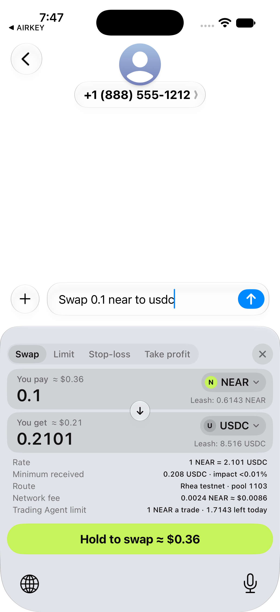
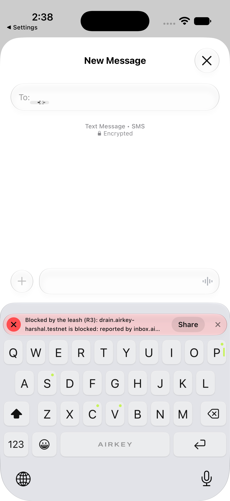
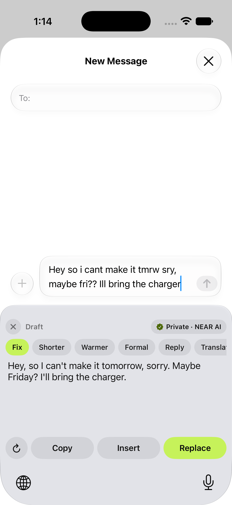

# Keybots

### Your keyboard is the AI. NEAR is the limit.

Keybots is an iPhone keyboard that can pay, swap and check messages without leaving the chat. Money only moves through **Spend Limits**, a NEAR contract that holds the funds and enforces your rules, so an AI that gets fooled still can't spend more than you allow.

**NEAR Hackathon · iOS · NEAR testnet, plus Spend Limits Lite on mainnet · Work in progress**

[Demo](docs/DEMO.md) · [Testnet evidence](docs/evidence/testnet-e2e.md) · [Rules](RULES.md) · [Try it without a phone](#try-it-without-a-phone)

> Testnet prototype. Not financial advice and not production wallet software. The app, code and screenshots still say AIRKEY in places.

## How we got here

1. **Xtrading:** our first product, a browser extension for trading straight from a post on X, built on Monad.
2. **Kall Markets:** built at ETHGlobal Mumbai. Watching people use Xtrading, the real question was "is this caller ever right?", so Kall Markets keeps a record of every caller's calls and puts trading in a keyboard. ([repo](https://github.com/harshalbhangale/Kall-Markets))
3. **Keybots:** built at this hackathon. The keyboard now holds AI agents that can pay and trade, and NEAR's Spend Limits contract decides what each one may do.

<p>
  
  
  
  
</p>

## What you can do

- **Pay by typing:** `pay harshal 0.2 for dinner`, then hold to send.
- **Swap on NEAR:** `swap 0.1 near to usdc`. Tokens are checked on NEAR Intents; testnet swaps run on Rhea.
- **Check a copied message:** a pasted payment request goes through stricter rules; a copied trading call becomes a trade you hold to confirm.
- **Follow traders on X:** calls from Keybots' X call tracker, with your own per-person rules. Auto-trading is off unless you turn it on.
- **Write better:** hold space to fix, rewrite, reply, translate or ask. Private AI on NEAR AI Cloud. Money words never go to the AI.

## One assistant, three lanes

Every money request goes down one of three lanes, picked by where the words came from, never by the AI.

| Lane | When | What it may do |
|---|---|---|
| **Your words** | You type a payment | Pay anyone up to your caps. An unknown account asks you first. |
| **Messages you copy** | You check a copied message | Pay only people on your allowed list. Never trades. |
| **Trades** | A swap, a price order, or a trader you follow | Swap within its own caps, apart from what payments may spend. |

Each lane is its own NEAR account (the Pay, Inbox and Trading agents: `pay.<you>`, `inbox.<you>`, `trader.<you>`). Its only key can ask Spend Limits for a payment or swap, and Spend Limits checks, in order: Stop everything, the blocked list, the per-payment cap, the daily cap, the allowed list, then your approval. The full order is in [RULES.md](RULES.md).

## Proof

On **testnet**, at [`leash.airkey-harshal.testnet`](https://testnet.nearblocks.io/address/leash.airkey-harshal.testnet):

| What happened | Transaction |
|---|---|
| A pasted "send 5 NEAR" was blocked by the 0.5 NEAR cap | [HMeo4MYz…](https://testnet.nearblocks.io/txns/HMeo4MYzcLWXSpkt9sn9qbnXBFfax4fC24nf2BHzD2kt) |
| A swap from the keyboard: 0.1 NEAR → 0.2101 USDC on Rhea | [89dXiQh4…](https://testnet.nearblocks.io/txns/89dXiQh4SToJM2c3tpFp9F7TgdyDT1b6CTnEPRSj7aaM) |
| Stop everything on, then a payment was blocked | [Hmk7LcjQ…](https://testnet.nearblocks.io/txns/Hmk7LcjQJsjaqnZL9WAgS4DmVxY6PrxhN121boMY8nuR) |

On **mainnet**, Spend Limits Lite runs at [`limits.hellbuddy.near`](https://nearblocks.io/address/limits.hellbuddy.near) with tiny caps and no swaps. It refused one payment ([FDKxnt6F…](https://nearblocks.io/txns/FDKxnt6FVY4scNL2e8npUjoDT7E566tyJhaadEBPPPDb)) and paid 0.01 NEAR ([6WgtSxcy…](https://nearblocks.io/txns/6WgtSxcybESMvn6ouJxCUnmdEPp7QtwCtBBHjFsHM3fm)).

More: the [full testnet run](docs/evidence/testnet-e2e.md) (9 real transactions) and the [demo run log](docs/evidence/demo-runs.md), failures included.

## Try it without a phone

Node.js 20+. This reads the live testnet contract and applies its rules; it signs and sends nothing.

```bash
git clone https://github.com/harshalbhangale/keybots.git
cd keybots/server && npm install
npm run try -- "pay harshal 0.2 for dinner"
npm run try -- "pay drain 5" --pasted
npm run try -- "swap 0.3 near to usdc"
```

## Run it

```bash
cd contracts/leash && cargo test          # the contract's rules
cd ../../server && npm install && npm test  # the server
npm start                                   # http://localhost:8787, needs testnet keys
```

iOS app and keyboard (Xcode and XcodeGen, iOS 26+):

```bash
cd ios && xcodegen generate
xcodebuild -project AirKey.xcodeproj -scheme AirKey -sdk iphonesimulator \
  -destination 'platform=iOS Simulator,name=iPhone Air' -derivedDataPath build CODE_SIGN_IDENTITY=- build
```

Testnet setup, hosting and the demo: [scripts/](scripts), [docs/HOSTING.md](docs/HOSTING.md), [docs/DEMO.md](docs/DEMO.md). Never commit keys or `.env` files.

## Limits

- The full contract runs on testnet; mainnet has only Spend Limits Lite, without swaps. Don't use this to protect real money.
- The server picks the lane from whether the text was typed or pasted; the contract can't prove where text came from.
- NEAR AI Cloud's checks depend on live services; if it's unavailable the server can fall back to OpenAI, which isn't private or signed. Every receipt names the provider that answered.
- Checked mostly on the simulator against testnet. No Android build.

## Credits

- The keyboard's typing core in `ios/AirKeyKeyboard/` (layout, design, typing engine and dictionary, and some panels) is adapted from [Kall Markets](https://github.com/harshalbhangale/Kall-Markets), which is not covered by this repository's MIT license.
- Haptics, hold-to-confirm and parts of the visual design come from Kall Markets.
- Built with Claude Code; product decisions by Harshal Bhangale.

## License

[MIT](LICENSE), except third-party code noted under Credits.
